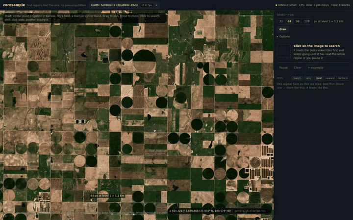

# coresample

[](https://davidackerman.github.io/coresample/)

Click something in a huge image or volume (EM, slides, planetary maps, sky surveys, satellite
imagery) and find more regions like it, in the browser, with **no precomputation**: no
embedding pass, no index. The data's own multiscale pyramid is the index: a quick pass over a
coarse level decides what to read first, and a model (DINOv2-small unless you pick another)
scores everything read.

**Try it: https://davidackerman.github.io/coresample/** (Chrome recommended: the model runs on
your GPU through WebGPU; without it, on the CPU, about 10x slower. On the CPU the page loads
twice the first time, to run the model in several threads: about 4x one thread; `?coi=0` keeps one).

## Using it

- **Search:** pick a dataset (or open your own with **Your data**, or drop a folder or an image
  on the page: [Data](#data)), zoom until the thing is clear, click.
  The panel has a bar for each stage (quick pass, model, detail: hover one for what it does),
  then hits stream in, best first; it
  keeps reading until it is done or you press **Pause**. With region on auto, on data too big
  for one quick pass, the quick pass keeps spreading outward from your click, nearest areas
  first, while the reads go to the best-scoring places of every area it has covered (not the
  area around the click first). It says how much it has covered and how long all of it would
  take: the search level is the one on screen, so zoom out first to cover more.
- **More examples:** shift-click (or **+ example**) adds another; hits then match their mean
  (Options > examples: or each hit's best match).
- **✓ / ✗ on a hit:** more / fewer like this. The query moves, the list re-ranks, and the tiles
  still to read are re-ordered. ✓ turns the hit green; undo under **Hits**.
- **match:** brightens the parts of each hit that look most like the middle of your box (or the
  parts you marked) and dims the rest; what every box has (plain background) does not count. **why:** each hit's score broken down, and its pieces
  coloured the way the model sees them.
- **what matters:** after a click, mark the parts of your box that matter, on an 8 x 8 grid (the
  pieces DINOv2-small sees). The match then compares only those pieces, where they sit in the box,
  and the search starts again (with DINOv2-small, the first time, 44 MB more of it). On labelled EM, a rough
  brush over the object found a few more in the top 10, not in the top 25 (test 12).
- **Heat:** how well every place compared matched, on the **Where it has looked** map (the
  whole dataset, the area searched so far outlined), and over the image if you tick **over the
  image** (in a volume, at the slice's depth).
- **draw:** sketch what to find, in the data's tones or any colour (**look like the data** turns
  colours into the data's own by brightness, white its brightest, and adds its grain). It finds bold shapes such
  as craters; on EM it finds nothing, so add real examples there.
- **Channels:** an image with several channels (fluorescence, say) opens as one Neuroglancer
  layer per channel, each with its colour and range in the layer's controls (from its metadata,
  else the first three on, in red, green and blue). The search sees what the viewer shows when you
  click: turn channels on or off, recolour or restretch them, and click again.
- **Viewers:** Neuroglancer for OME-Zarr and precomputed volumes (your clicks in blue, hits in
  yellow), OpenLayers for tile maps, a globe for Mars and the Moon (**map** switches to the
  flat map). The bottom right shows the coordinates under the cursor and takes coordinates
  to go to.

## How it works

1. **Quick pass:** brightness and texture statistics over a coarse level rank where similar
   things might be (no model; a few MB).
2. **Rough pass** (GPU): DINOv2-small (112 px), or the model picked in **Options > model**,
   reads the same areas two levels coarser (a sixteenth of the download, in 2-D), in the quick
   pass's order, and scores every place there against your click at that level. The most
   promising 10% of the tiles it has scored are then read in full detail (on EM, the top 5%
   already matched reading everything). **Read the rest** reads the others.
3. **Score:** every patch in the tiles read in detail goes through the same model; the score
   under each hit is the cosine of its embedding with your click's (the mean of **look**, the
   CLS token, and **parts**, the average piece token). Memory stays bounded: the best 3,000
   candidates are kept for re-ranking.

Nothing is uploaded. The live site counts dataset views and searches with GoatCounter (no
cookies; your own data counts only as its format, never its address). The **Options** (detailed 224 px input, centre object, any rotation, any
size, adapt to data, tiles + tokens, combining examples) are for data where they make sense:
on labelled EM none moved top-10 precision by more than a few hundredths (tests 5-9,
[RESULTS.md](experiments/results/RESULTS.md)). **Options > model** has two more models (test 6):
MorphEm (MIT; trained on single fluorescence channels, so it sees grey), the only one that found
more on labelled HeLa EM, 6.4 of the top 10 right to DINOv2-small's 5.7, and more Mars craters
on plains (test 13); and PE-Core-T (Apache-2.0), 4.6x as fast without a GPU, 5.1 of the top 10
right there. Its look (class token)
is nearly the same for every patch (cosine 0.999), so choosing it turns on **adapt to data**,
which spreads its scores out and finds as many (test 6). Choosing another model (or method)
asks whether to search again with it; the search running keeps the one it began with. Each
model's source, licence and changes: [web/public/models/NOTICE.txt](web/public/models/NOTICE.txt) (**licences** beside the picker).

## Data

| how | example |
|---|---|
| a preset | `?d=mars-ctx`, `moon-wac`, `jezero` (one TIFF, no pyramid), `andromeda`, `webb`, `legacy-sky`, `legacy-ngc6129`, `s2` (the default), `hela`, `idr-organoid`, `idr-lung` |
| OME-Zarr (v0.4/0.5, 2-D or 3-D, sharded or not) | `https://...`, `s3://bucket/path`, `gs://bucket/path` |
| Neuroglancer precomputed | `precomputed://gs://neuroglancer-janelia-flyem-hemibrain/emdata/clahe_yz/jpeg` |
| web-map tiles | `https://host/.../{z}/{x}/{y}.png` (`#maxZoom=12` sets the finest zoom) |
| Zoomify | `https://host/.../ImageProperties.xml` |
| a TIFF on the web (GeoTIFF, COG, BigTIFF; 2-D) | `https://host/.../image.tif`: its own pyramid if it has one; if not, coarser levels made as it is read, from every 2nd, 4th... row |
| a Legacy Surveys field | `legacy:245.43,37.996` (RA, Dec) |
| a folder on this computer | drop it on the page, or **Your data** > **Choose a folder** (Chrome, Edge): an OME-Zarr (or a folder with some inside: it opens the first), or a precomputed volume |
| an image file on this computer | drop it on the page, or **Your data** > **Choose an image**: PNG, JPEG, WebP, GIF, BMP, AVIF, or TIFF (multi-page: z planes and channels as its OME-XML or ImageJ description says, else z planes), read whole into memory (up to 1.5 billion values; bigger, convert it to OME-Zarr) |

Paste a link under **Your data**; the address bar then holds `?url=...` and the view
(`&v=x,y,z,scale`), so a copied link opens the same place. A folder or image is read where it is (a
service worker, `web/public/local-sw.js`, serves it to the page and Neuroglancer, an image as an
OME-Zarr made on the fly, `web/src/imagefile.ts`; nothing is uploaded), so there is no link to it. Other address options: `&globe=0`
(flat map), `&rough=0` / `&rough=1` (rough pass off / forced on a CPU). The data must be a
multiscale pyramid (a TIFF need not be) on a host that allows cross-origin reads (CORS), as public buckets, NASA
Trek, ESA and IDR do. A TIFF is read by byte ranges (`web/src/remotetiff.ts`) and served to the
page as an OME-Zarr made on the fly. Without a pyramid, a level 2^k coarser reads one row in 2^k
(an uncompressed row costs only its bytes; a compressed tile or strip is read whole, so a
compressed TIFF needs one), and a finer level reuses the rows a coarser one read. Zooming out and
the quick pass therefore read more than a pyramid would. On Jezero (7.4 GB) the first view read
29 MB, and a search's quick pass over the whole crater about 105 MB. USGS Astrogeology's bucket
holds many such mosaics, up to Venus at 117 GB. S3 and IDR let a browser download only 6 files at once per address, so
the page also reads through their other addresses for the same data.

## Run locally

```bash
cd web && npm install && npm run model   # exports the models to ONNX (188 MB, gitignored)
npm run build && npx vite preview        # http://localhost:5180
```

The site is built by `.github/workflows/pages.yml` (Neuroglancer from source with
`web/scripts/patch_neuroglancer.sh`, the ONNX models with `web/scripts/export-requirements.txt`, chunkmirage at `web/chunkmirage.lock`).
The same search runs from the command line too, and chunk sizes alone make a map of where the
content is (no pixel reads):

```bash
uv sync
uv run python experiments/query.py zarr://s3://janelia-cosem-datasets/jrc_hela-2/jrc_hela-2.zarr/recon-1/em/fibsem-uint8 \
    --point 1700,400,2600 --working 2 --coarsest 4 --patch 64 --k 100 --top 20
uv run experiments/chunkmap.py zarr://s3://janelia-cosem-datasets/jrc_hela-2/jrc_hela-2.zarr/recon-1/em/fibsem-uint8
```

## Layout

| path | what |
|---|---|
| `web/` | the browser tool (TypeScript): readers, the search, DINOv2 through ONNX Runtime Web, the viewers |
| `experiments/` | the Python side: search logic, CLI, chunk-size maps, and the ten feasibility tests ([README](experiments/README.md)) |
| `experiments/results/` | the tests' numbers and write-up ([RESULTS.md](experiments/results/RESULTS.md)) |

## Inspiration

Inspired by [Clio](https://clio.janelia.org)'s image search ([Huang et al. 2020](https://arxiv.org/abs/2012.12175)),
which learns each dataset's features and precomputes their signatures. coresample is a much
simpler, rougher take: an off-the-shelf model run on the raw data as it is read, which is what
lets it work on any dataset in the browser without any precompute.
