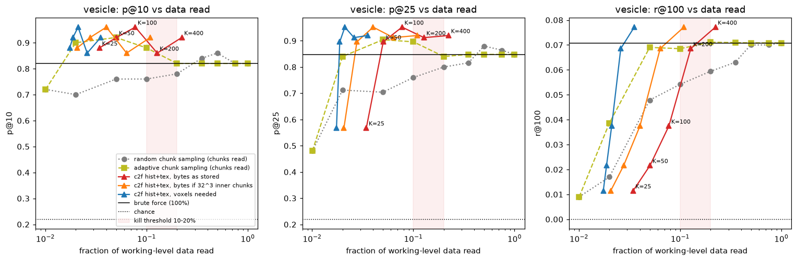
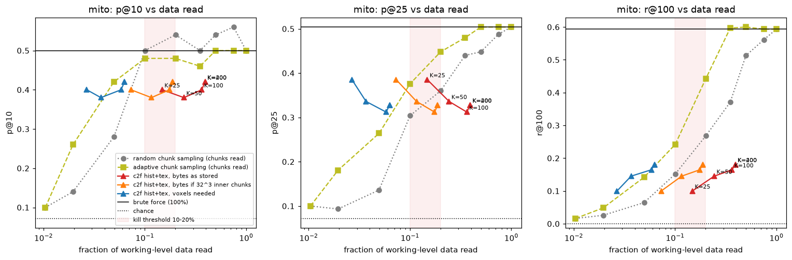
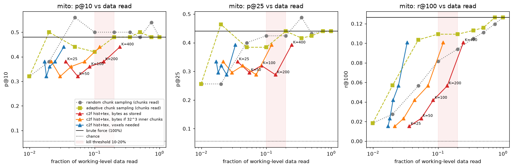
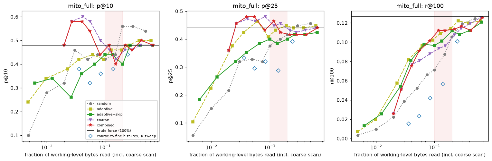
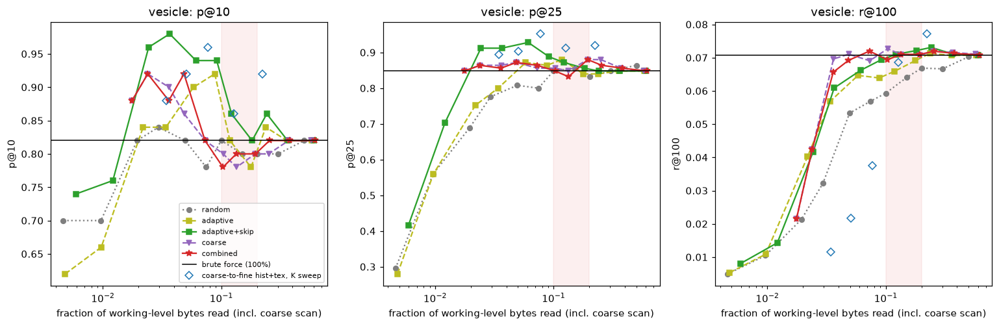
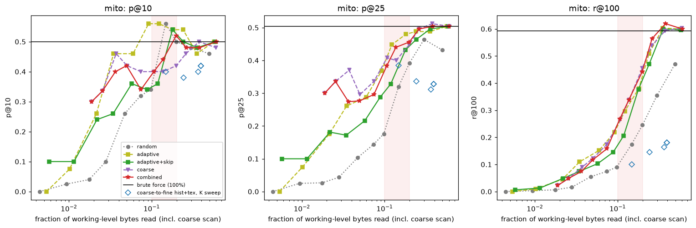

# coresample feasibility: results

In short (details and numbers below):

1. **Chunk sizes** map cell vs resin for free (AUC 0.95-0.98), organelles only weakly.
2. **Cutting candidates level by level** works for vesicles (3-8% of the bytes) and loses mito.
3. **Reading the coarse scan's top chunks whole** matches brute force on the top hits at about
   2.5% of the bytes; the page's search is built on this.
4. **Good/bad feedback** helps a little, not consistently.
5. **Comparison options** (pooling, rotation, 224 px, centring): none moves precision by more
   than 0.02; the default stays.
6. **Other models:** none beats DINOv2-small on both targets.
7. **Tile tokens** (the Mars CTX explorer's matching) match the default with fewer model runs.
8. **The model two levels up** orders the reads best: its top 5% match reading everything (the page's rough pass reads its top 10%).
9. **Several examples** help where the class looks alike (vesicles +0.11 with 8 averaged).
10. **Drawings** find nothing on EM.
11. **Surroundings 4x the box** rule out three quarters of the regions at no loss, halving the model's work (not the downloads).

Dataset: `jrc_hela-2` (OpenOrganelle), EM `recon-1/em/fibsem-uint8`, 6368 x 1600 x 12000
voxels at 5.24 x 4 x 4 nm, six 2x levels (s0 chunks 128^3, s1-s5 chunks 64^3, zstd 6),
read lazily from `s3://janelia-cosem-datasets`. Reference labels are the whole-volume COSEM
segmentations (`*_seg`, N5), used only to choose queries and grade; they are curated model
output, not manual ground truth, which exists only in 26 small crops. The search code
(`search.py`, `query.py`) never sees labels. Layout: [layout.md](layout.md).

## Test 1: compression heatmap

Map cell = one s0 chunk (128^3 voxels, 0.67 x 0.51 x 0.51 um); 54,684 full cells,
23,591 inside the cell (foreground mask > 50%). Sizes come from `chunkmap.py` (bucket
listing: 61,100 s0 sizes in 2 s, no pixels read). Label occupancy: mito and vesicle from
8 nm labels, the any-organelle union of 18 classes from 32 nm labels.

| signal | AUC cell vs resin | AUC mito, within cell | AUC vesicle, within cell | Spearman any-organelle, within cell |
|---|---|---|---|---|
| zarr uint8 zstd s0 size (free) | 0.95 | 0.67 | 0.57 | 0.79 |
| zarr uint8 zstd s1 size (free) | 0.89 | 0.69 | 0.66 | 0.62 |
| zarr uint8 zstd s2 size (free) | 0.92 | 0.66 | 0.55 | 0.62 |
| N5 uint16 gzip s0 size (free) | 0.94 | 0.69 | 0.57 | 0.81 |
| s0/s1 size ratio, same region (free) | **0.98** | 0.65 | 0.56 | 0.77 |
| s0 size minus local median (free) | 0.72 | 0.53 | 0.61 | 0.04 |
| residual from size-vs-coarse-intensity trend | 0.90 | 0.64 | 0.66 | 0.41 |
| abs(residual), outlier rank | 0.73 | 0.59 | 0.59 | 0.24 |
| EM s3 intensity std (reads 1/512 of s0) | 0.92 | 0.57 | 0.50 | 0.59 |

Across all cells, resin included, size predicts mito at AUC 0.87 and vesicles at 0.88, but
that is mostly "cell or resin". The maps ([test1_heatmaps.png](test1_heatmaps.png)) show
the nucleus with its chromatin texture, the cell outline and the mito-rich ring around the
nucleus.

- **Free beats a cheap read.** Within the cell, s0 chunk size (no pixels) predicts mito and
  vesicles better than the intensity std of EM s3: size carries fine-scale information that
  downsampling averages away.
- **Raw EM barely compresses.** s0 chunks are 1.0-1.6 MB of 2.1 MB raw (59.6 GB stored for
  122 GB); the median s1 chunk is 258 KB of 262 KB, close to stored raw. Size saturates where
  the texture is.
- **Compressor type barely matters.** N5 uint16 gzip gives the same picture as zarr uint8 zstd.
- **Acquisition state shows.** An anomalous z-plane, a z-band of larger background chunks, and
  a missing row in the foreground mask itself are all visible: the QA use (corruption,
  imaging changes, write progress).
- **The texture-vs-intensity residual** ([test1_residual.png](test1_residual.png)) helps
  vesicles a little (0.66 vs 0.57), not mito; its outlier rank is near chance for organelles
  and mostly finds nucleus texture and acquisition bands. Constant edge chunks must be left out
  of the trend fit or they dominate it.

`chunkmap.py` on real buckets (the handoff's open item; the parallel listing fix holds):

| dataset | levels | chunk sizes | time |
|---|---|---|---|
| jrc_hela-2 zarr, s0-s5 (`--max-chunks 5000000`) | 6 | 122,850 | 10.7 s |
| jrc_hela-2 N5 uint16, s0-s4 (new N5 support) | 5 | 540,741 grid positions | 17 s |
| hemibrain precomputed, sharded JPEG, 32-2048 nm | 7 | 3.47 M | 59 s (32 nm: 3.41 M in 44 s, 7,140 minishard index reads) |

The hemibrain map shows neuropil compartments and acquisition-slab seams from sizes alone
([chunkmap/hemibrain_32nm.png](chunkmap/hemibrain_32nm.png)). `chunkmap.py` now stretches
its colours over non-empty chunks; a few hundred constant edge chunks used to wash out the
cell.

## Test 2: coarse-to-fine recall

**Setup.** Subvolume s0 z 640-2688, all y, x 512-4608 (10.7 x 6.4 x 16.4 um, about 1/9 of the
volume: cytoplasm left of the nucleus, a nucleus edge, some resin;
[overview_s4.png](overview_s4.png)), plus the whole volume for mito. Five query instances per
class. A returned region is a patch^3 box at the working level; it is a hit if it contains an
instance centroid; results are non-overlapping (NMS) and exclude the query's own box.

| target | working level | patch | instances | chance precision | brute force |
|---|---|---|---|---|---|
| vesicle (hard) | s1, 8 nm | 64 px = 512 nm | 3,440 | 0.22 | 46,872 patches, 1.41 GB, 215 s to embed |
| mito (easy) | s2, 16 nm | 64 px = 1 um | 62 | 0.07 | 5,115 patches, 153 MB |
| mito, whole volume | s2 | 64 px | 421 | 0.06 | 48,576 patches, 1.28 GB, 204 s |

Coarse-to-fine: cheap scores over the whole coarsest level (FFT NCC with 8 in-plane
rotations, 16-bin histogram EMD, window texture stats: mean, std, gradient, DoG), keep K
peaks, rescore a small box around each at every finer level, then DINOv2-small (xy patch,
112 px input, CLS + mean token) ranks the survivors at the working level. Data read is
costed from the listing's real chunk sizes: as stored (whole 64^3 chunks), as if sharded
with 32^3 inner chunks, and as the voxels actually needed. Fractions are of the working
level over the searched region.

### Vesicles: pass

| method | p@10 | p@25 | r@100 | bytes as stored | 32^3 inner | voxels |
|---|---|---|---|---|---|---|
| brute force | 0.82 | 0.85 | 0.07 | 100% | 100% | 100% |
| c2f s3, K=25, hist+tex | 0.88 | 0.89 | 0.01 | **3.4%** | 2.1% | 1.7% |
| c2f s3, K=100, hist+tex | 0.96 | 0.95 | 0.04 | 7.7% | 4.0% | 2.1% |
| c2f s3, K=400, hist+tex | 0.92 | 0.92 | 0.08 | 22.3% | 10.9% | 3.5% |
| c2f s4, K=100, hist+tex | 0.98 | 0.91 | 0.03 | 6.8% | 3.1% | 0.8% |
| c2f s5, K=100, hist+tex | 0.92 | 0.86 | 0.03 | 6.7% | 2.9% | 0.6% |
| adaptive sampling, 2% of chunks | 0.90 | 0.84 | 0.04 | 2% | | |
| adaptive sampling, 5% of chunks | 0.92 | 0.90 | 0.07 | 5% | | |
| random sampling, 10% of chunks | 0.76 | 0.76 | 0.05 | 10% | | |

- **Coarsest usable level: s5** (128 nm), the coarsest the dataset has, although a single
  vesicle (40-100 nm) is sub-voxel there. The search finds vesicle-dense neighbourhoods by
  texture, which is what "a region containing a vesicle centroid" rewards. It is region-level
  search, not instance-level.
- **Rough results in seconds.** The cheap s4 scan alone (3.7 s, no embedding) gives p@10 0.84;
  the full s4 search (cheap 7 s, embed 0.6 s, about 96 MB) reaches p@10 0.98, against about 4
  minutes for brute force (215 s embedding, 1.41 GB).
- **Recall@100** is capped by K: 100 boxes cover few of 3,440 instances (brute force 0.07);
  K=400 reaches brute-force recall at 22% of bytes as stored, 11% with 32^3 inner chunks.

### Mito: fail

Subvolume:

| method | p@10 | p@25 | r@100 | bytes as stored | 32^3 inner | voxels |
|---|---|---|---|---|---|---|
| brute force | 0.50 | 0.50 | 0.59 | 100% | 100% | 100% |
| c2f s4, K=100, ncc+hist+tex | 0.46 | 0.41 | 0.21 | 29.7% | 16.4% | 4.7% |
| c2f s4, K=100, hist+tex | 0.40 | 0.31 | 0.16 | 36.4% | 17.5% | 5.8% |
| c2f s4, K=100, tex | 0.50 | 0.32 | 0.17 | 38.6% | 18.9% | 5.7% |
| c2f s4, K=25, hist+tex | 0.40 | 0.39 | 0.10 | 14.8% | 7.3% | 2.7% |
| c2f s3, K=100, hist+tex | 0.50 | 0.34 | 0.16 | 30.7% | 18.3% | 12.8% |
| random sampling, 10% of chunks | 0.50 | 0.30 | 0.15 | 10% | | |
| adaptive sampling, 20% of chunks | 0.48 | 0.45 | 0.44 | 20% | | |

Whole volume:

| method | p@10 | p@25 | r@100 | bytes as stored | 32^3 inner | voxels |
|---|---|---|---|---|---|---|
| brute force | 0.48 | 0.44 | 0.13 | 100% | 100% | 100% |
| c2f s4, K=25, hist+tex | 0.38 | 0.33 | 0.02 | 3.6% | 2.2% | 1.7% |
| c2f s4, K=100, hist+tex | 0.36 | 0.32 | 0.04 | 8.4% | 4.4% | 2.0% |
| c2f s4, K=400, hist+tex | 0.44 | 0.39 | 0.10 | 24.6% | 12.1% | 3.4% |
| random sampling, 5% of chunks | 0.56 | 0.40 | 0.06 | 5% | | |
| adaptive sampling, 2% of chunks | 0.50 | 0.46 | 0.06 | 2% | | |

- The cheap coarse ranking is the weak link: its p@10 is 0.28-0.44 at s4 (vesicles: 0.84 at s4, 0.90 at s3).
  Window statistics at 64 nm cannot tell mito from other membrane-rich cytoplasm; DINOv2
  re-ranking recovers the top 10 but the candidate set misses most instances.
- Searching more volume lowers the fraction as expected (K=100: 30-36% of the subvolume, 8% of
  the whole volume) but precision falls with it, and matching brute force then needs K=400.
- The "easy" target is the hard one for this method: mito are defined by shape, vesicle-rich
  regions by texture, and the cheap scores only see texture.

### Sensitivity

- **Cheap score.** Histogram and texture work; NCC alone does not (vesicle p@10 0.62, mito 0.24,
  mito coarse p@10 0.00): a rigid template does not follow shape and orientation even with 8
  rotations. A bug in the first run let NCC score flat windows (resin, padding) as huge matches;
  it is fixed (flat windows score 0) and every NCC row was rerun.
- **K.** Precision is roughly flat in K and noisy across queries, while recall and cost grow
  roughly linearly. At s4 over the subvolume there are
  only about 170 distinct peaks, so K=200 and K=400 coincide for mito there.
- **Coarsest level.** Vesicles: s5, s4 and s3 all match brute force. Mito: none does.
- **Chunk granularity dominates cost.** Bytes as stored are 4-9x the voxels needed, because one
  64-px slice reads a whole 64^3 chunk. Sharded zarr v3 with 32^3 inner chunks halves it.
- **Self-building index.** In the rerun, 68% (mito) and 44% (vesicle) of candidate embeddings
  came from the cache that earlier searches had filled (`cache/embeddings.sqlite`).

## Test 3: combining the cheap signals (follow-up)

Proposed at the end of Test 2 and run once, with parameters fixed in advance (seed 1% of
chunks, 0.5% random exploration, equal weight on prior and feedback; no tuning). Every
strategy reads whole working-level chunks and embeds every grid patch in each chunk it
reads, so they differ only in which chunks they read, in what order. Costs include the
whole coarsest level over the region (1.2% of working-level bytes) for coarse-using
strategies. Driver: `search.best_first_chunks`; harness: `test3_combined.py`.

| strategy | what it uses |
|---|---|
| random | nothing |
| adaptive | 1% random seeds, then expand around the best similarities |
| adaptive+skip | adaptive, never reading chunks the free size map calls empty |
| coarse | chunks in order of the cheap coarse scan (hist+tex at s4 for mito, s3 for vesicles) |
| combined | skip empty, seed with the coarse scan's top 1%, expand on coarse prior + neighbours' similarity |

The empty mask uses only s0 chunk sizes: near-constant chunks plus the lower Otsu class
when the split is clearly bimodal. Over the whole volume it marks 19% of chunks empty and
drops 60 of 23,591 cell chunks (0.25%), catching a third of the resin.

p@10 / p@25 at matched budgets (bytes read including the coarse scan in brackets):

| run | brute force | random, 1% | adaptive, 1% | coarse or combined, 1% | adaptive, 5% | coarse, 5% |
|---|---|---|---|---|---|---|
| vesicle | 0.82 / 0.85 | 0.70 / 0.56 | 0.66 / 0.56 | **0.92 / 0.86** (2.4%) | 0.90 / 0.87 (5.8%) | 0.82 / 0.86 (7.3%) |
| mito, whole volume | 0.48 / 0.44 | 0.28 / 0.15 | 0.34 / 0.22 | **0.58 / 0.46** (2.7%) | 0.44 / 0.46 (6.2%) | 0.50 / 0.48 (8.4%) |
| mito, subvolume | 0.50 / 0.50 | 0.03 / 0.03 | 0.07 / 0.07 | 0.34 / 0.34 (2.5%) | 0.46 / 0.29 (6.0%) | 0.40 / 0.34 (7.4%) |

- **The coarse scan is worth exactly its first few percent.** Reading its top-ranked chunks
  first gives brute-force-level top hits at about 2.5% of the bytes for vesicles and
  whole-volume mito; random and adaptive sampling need at least twice the bytes for the same
  precision, or never reach it below 20%.
- **Read chunks, not points.** At the same bytes, Test 2's descent to single candidates
  embedded one patch per candidate and lost the target when coarse localization was off; a
  chunk read whole costs the same bytes and embeds all of its 8 patches (whole-volume mito
  at about 3% of the bytes: p@10 0.38 point-wise, K=25, vs 0.58 chunk-wise).
- **Feedback and the size map add little.** `combined` tracks `coarse`; expansion around good
  hits does not beat the static coarse order, and skipping empty chunks helps vesicles a bit
  (p@25 0.91 at 2% of chunks) and nothing else consistently.
- **Recall is not instant.** r@100 grows with data read for every strategy; the gain is in the
  first good hits, which is what the browser shows first.
- The s4 whole-volume scan takes about 33 s in numpy (s3 over the subvolume, 36 s): fine for a
  test, the part to move to WebGPU.

## Test 4: relevance feedback (follow-up)

A simulated person pages through results 10 at a time and marks each shown region good or
bad (graded with the labels, as a person would judge by eye); after each page everything not
yet shown is re-ranked. Five pages, five queries per run, the brute-force embeddings as the
pool (`test4_feedback.py`).

Distinct instances found in the 50 regions shown:

| run | no feedback | Rocchio (move the query toward good, away from bad) | logistic regression on the marks |
|---|---|---|---|
| mito, subvolume | 26.0 | 26.4 | 25.4 |
| mito, whole volume | 27.0 | 30.2 | 24.0 |
| vesicle | 122.8 | 124.4 | 134.0 |
| mito, whole volume, pool = coarse top 2% of chunks | 22.4 | 22.0 | 27.0 |
| vesicle, pool = coarse top 2% of chunks | 121.0 | 118.6 | 118.4 |

**Feedback helps little and not consistently** (Rocchio 0 to +12%, logistic regression -10% to
+20%). With about half of the first page right for mito, ten marks do not teach a better
boundary in DINOv2's space; the model, not the ranking, is the ceiling. Rocchio stays in the
browser tool as a button (it rarely hurts); a better or domain model is the bigger lever.

## Test 5: how to compare embeddings (follow-up)

Which embedding and similarity find the most right regions, the candidates fixed (the
brute-force patch grid of each run) so only the comparison varies (`test5_matching.py`). Pools:
CLS token, mean of patch tokens, centre-weighted mean (the object at the click), and their
pairs; query as is or the best of its 8 rotations/flips; similarity cosine, centred (minus the
candidates' mean), or query expansion (qe, the query plus its top 5); input 112 or 224 px.
A first run with 10 queries per target was too noisy to choose from (+/-0.1, and the one big
gain, 224 px on the mito subvolume, reversed on the whole volume). This run: **30 queries per
target, every variant on the same queries, differences paired per query** (90 queries pooled):

| option in the page | p@10 vs default | p@25 vs default |
|---|---|---|
| default: fast (112 px), whole patch (CLS + mean of tokens), cosine | 0.48 / 0.81 / 0.44 | 0.46 / 0.80 / 0.43 |
| detailed (224 px input) | +0.009 +/- 0.019 | -0.003 +/- 0.013 |
| center object (CLS + centre-weighted tokens) | +0.004 +/- 0.010 | +0.004 +/- 0.006 |
| any rotation (best of 8) | +0.004 +/- 0.015 | -0.013 +/- 0.010 |
| adapt (centred cosine) | +0.001 +/- 0.009 | +0.002 +/- 0.006 |
| best of all 24 variants: centre tokens + rotation + 224 px | +0.041 +/- 0.022 | +0.030 +/- 0.013 |
| good/bad feedback (Rocchio, 1 page of marks) | +0.00 / +0.04 / +0.04 | +0.00 / +0.05 / +0.02 |

(The default row is mito subvolume / vesicles / mito whole volume; the rest are paired
differences +/- standard error over the 90 queries, except feedback, per target.)

**No option changes precision by more than 0.02.** The best of the 24 variants gains 0.03-0.04,
about 2 standard errors, which is what the best of 24 draws of noise looks like; it is not
taken as a win. The page keeps the default and offers the options for data where they make
sense (rotation for craters and galaxies, centre focus when surroundings vary); the model, not
the comparison, is the lever (test 6 compares models: none beats DINOv2-small on both targets).

## Test 6: other models (follow-up)

Does another model find more right regions? `test6_models.py` keeps the candidates (each
run's brute-force patch grid) and test 5's 30 queries per target, and changes only the model;
differences are paired per query against DINOv2-small, the page's model (+/- standard error):

| model | input, embedding | vesicles p@10 / p@25 | mito, whole volume p@10 / p@25 | CPU time, one target |
|---|---|---|---|---|
| **DINOv2-small** (the page's) | 112 px, CLS + mean token | 0.81 / 0.80 | 0.44 / 0.43 | 3-5 min |
| DINOv2-base (4x the parameters) | 112 px, CLS + mean token | -0.03 +/- 0.03 / -0.03 +/- 0.03 | -0.05 +/- 0.03 / -0.07 +/- 0.02 | 11-32 min |
| DINOv2-small with registers | 112 px, CLS + mean token (registers left out) | -0.02 +/- 0.04 / -0.02 +/- 0.03 | -0.09 +/- 0.04 / -0.10 +/- 0.03 | 4-10 min |
| DINOv3-small | 128 px (the same 8 x 8 tokens), CLS + mean token | +0.04 +/- 0.04 / +0.05 +/- 0.03 | +0.00 +/- 0.05 / -0.04 +/- 0.03 | 11-14 min |
| SigLIP-base (image-text) | 224 px, pooled | +0.06 +/- 0.04 / +0.04 +/- 0.03 | -0.03 +/- 0.04 / -0.05 +/- 0.02 | 48-108 min |
| CLIP ViT-B/16 (image-text) | 224 px, pooled | +0.00 +/- 0.04 / +0.02 +/- 0.03 | -0.02 +/- 0.04 / -0.05 +/- 0.03 | 52-73 min |
| CEM500K (ResNet-50 trained on 500k EM images) | 224 px grey, average pool | +0.00 +/- 0.03 / +0.02 +/- 0.02 | +0.01 +/- 0.04 / -0.02 +/- 0.03 | 23-27 min |
| texture (LBP + Gabor, no learning) | 64 px | -0.04 +/- 0.04 / -0.04 +/- 0.03 | -0.11 +/- 0.05 / -0.10 +/- 0.03 | (Python loop) |

(DINOv3-small also ran on the mito subvolume: +0.03 +/- 0.03 / -0.01 +/- 0.02. Times are for
embedding every candidate, about 47,000 patches, on 20 CPU cores.)

**No model beats DINOv2-small on both targets.** The gains are on vesicles, a dense,
texture-like target (DINOv3-small and SigLIP +0.04 to +0.06, under 2 standard errors); the
losses are on mitochondria, a shape (up to -0.07 at p@25, 2-3 standard errors for DINOv2-base
and SigLIP). Bigger is not better here: DINOv2-base is behind on both. DINOv3-small comes
closest (ahead on vesicles, level at p@10 and behind at p@25 on mito), at 2-4x the time, and
its weights are gated (a license accepted on Hugging Face), so the page cannot ship it without
a decision. The image-text models cost 10-20x per patch and do worse on shape, and the
hand-made texture descriptor falls furthest behind on it, so learned features earn their
place. CEM500K, trained on EM alone, only draws level (and finds slightly more of the
instances in its top 100: recall@100 +0.005 +/- 0.002 on vesicles, +0.011 +/- 0.006 on mito)
at 5-8x the time, so the general model loses nothing on this EM. DINOv2-small trained with
register tokens (meant to remove the artifact tokens that can skew a mean of tokens, the
"parts" score) is the same size and cost but clearly worse on mito (-0.10 at p@25, 23 of 30
queries worse): at 112 px the plain model's mean token is not hurt by artifacts here. The page
keeps DINOv2-small.
One grey EM dataset: on colour data (Earth, Mars), where there are no labels here to grade
with, the image-text models and DINOv3 may rank differently.

## Test 7: the Mars CTX explorer's matching (follow-up)

mars_ctx_explorer (DINOv3 over Mars CTX tiles) embeds each tile once, keeps every patch token,
and matches a box by its tokens: slid as a template over the candidates' token grids (mean
cosine of aligned tokens), or as the mean of its tokens against the mean of each window's.
`test7_template.py` does the same with DINOv2-small on the EM: each plane cut into 224 px crops
(resampled so a 64 px patch spans 8 x 8 tokens, as the baseline's 112 px input does), each crop
embedded once, the token grids stitched, every window at every token (8 px) scored. Same 30
queries as test 5, differences paired against its default:

| | mito, subvolume | vesicles | mito, whole volume |
|---|---|---|---|
| default (one embedding per patch), p@10 / p@25 | 0.48 / 0.46 | 0.81 / 0.80 | 0.44 / 0.43 |
| template (aligned tokens), p@25 | -0.064 +/- 0.024 | +0.003 +/- 0.026 | -0.044 +/- 0.025 |
| **pooled (mean of the window's tokens)**, p@10 | -0.007 +/- 0.032 | +0.057 +/- 0.035 | -0.023 +/- 0.043 |
| **pooled**, p@25 | -0.001 +/- 0.023 | +0.037 +/- 0.028 | -0.000 +/- 0.021 |

**Pooled tokens match the per-patch default** (equal on mito, slightly ahead on vesicles), and
the aligned template is worse: a sliding template asks for the same layout, the mean asks for
the same content. It costs one model pass per crop (twice the patch size) instead of one per
patch, and places hits at 1/8 of a patch instead of half. The page has it as a method, "tiles +
tokens (Mars CTX explorer)": the 224 px model now outputs its tokens (the page pools the
"detailed" embedding from them; identical to the old export to 1.5e-7).

## Test 8: what should decide which tiles are read first (follow-up)

The page reads whole working-level tiles in the cheap scan's order (test 3). Test 2's cascade,
which cut at every level, lost mito because the cheap scores cannot see them. Here the model
itself, one or two levels coarser, decides the order instead of cutting: one patch of the same
physical box per working tile at level W+1 or W+2 (P/2 or P/4 px), tiles ranked by their best
coarse match, nothing skipped (`test8_levels.py`). Every order uses the same working-level
embeddings for the tiles it has read (test 5's cache), so only the order differs. Same 30
queries; p@10 after reading a share of the tiles, and in brackets the download including what
the order itself needed:

| order | mito, 1% of tiles | mito, 5% | vesicles, 1% | vesicles, 5% | mito whole volume, 1% | 5% |
|---|---|---|---|---|---|---|
| random | 0.06 (1.0%) | 0.27 (4.8%) | 0.76 (1.0%) | 0.81 (5.0%) | 0.25 (1.0%) | 0.38 (5.0%) |
| cheap scan (the page before) | 0.33 (2.6%) | 0.41 (7.5%) | 0.79 (2.4%) | 0.83 (7.3%) | 0.35 (2.6%) | 0.34 (8.0%) |
| model at W+1 | 0.43 (12.0%) | 0.51 (17.0%) | 0.79 (12.1%) | 0.80 (17.0%) | 0.43 (12.3%) | 0.48 (18.0%) |
| **model at W+2** | **0.42 (2.6%)** | **0.53 (7.6%)** | 0.82 (2.4%) | 0.80 (7.3%) | **0.41 (2.7%)** | **0.43 (8.4%)** |

(Every tile read: p@10 0.48 mito, 0.81 vesicles, 0.44 whole-volume mito.) **The model two
levels up finds the mito tiles sooner than the cheap scan at the same download**, in the
subvolume and in the whole volume: after 1% of the tiles it is at or near the all-tiles
precision. W+1 does as well but costs about 10% of the working level to look at. On vesicles
every order is near the ceiling from the start (they are everywhere), so the order does not
matter there. The page has this as the "rough pass" (GPU by default).

## Test 9: several examples (follow-up)

The page lets you add examples to a query (shift-click). Earth Engine's similarity search and
similar.earth average the examples' embeddings; the alternative keeps them apart and scores each
candidate by its best match among them. `test9_examples.py`: for each of the 30 queries, its
k - 1 extra examples are other queries of the list (instances elsewhere, drawn at random,
nested), every example's own patch left out of the hits. Change in p@10 from one example
(paired, +/- standard error):

| | mito, subvolume | vesicles | mito, whole volume |
|---|---|---|---|
| one example, p@10 | 0.48 | 0.81 | 0.44 |
| mean of 2 | -0.03 +/- 0.03 | +0.04 +/- 0.04 | -0.02 +/- 0.04 |
| mean of 3 | -0.01 +/- 0.04 | +0.04 +/- 0.04 | +0.06 +/- 0.04 |
| mean of 5 | -0.04 +/- 0.03 | +0.09 +/- 0.04 | +0.05 +/- 0.04 |
| mean of 8 | -0.03 +/- 0.04 | **+0.11 +/- 0.04** | +0.06 +/- 0.04 |
| best match among 2 | **+0.04 +/- 0.03** | +0.04 +/- 0.03 | +0.02 +/- 0.03 |
| best match among 3 | +0.03 +/- 0.04 | +0.03 +/- 0.04 | +0.04 +/- 0.03 |
| best match among 8 | -0.02 +/- 0.04 | +0.05 +/- 0.04 | +0.04 +/- 0.04 |

(p@25 moves the same way, the best match gaining more there: +0.07 on mito with 2 examples.)
**More examples help where the class looks alike** (vesicles: +0.11 with 8 averaged, the
largest gain of any option so far), and the whole-volume mito gains a little either way. On the
mito subvolume averaging blurs instances that look different, and the best match does better.
The page averages by default, as Earth Engine does, and offers "match any one of them".

## Test 10: a drawing as the query (follow-up)

Can you draw what you are looking for? The model has never seen drawings. Stand-in for a person
drawing (`test10_sketch.py`): each query's own ground truth rendered as a sketch, the outline of
the object clicked or of every labelled object in the box, filled or not, on the data's median
grey in the data's own tones, plain or blurred with the data's grain added. p@10 over the 30
queries:

| query | mito | vesicles |
|---|---|---|
| the real patch (a click) | 0.48 | 0.81 |
| best sketch: every object, filled, with grain | 0.13 | 0.00 |
| the other 7 kinds of sketch | 0.00-0.10 | 0.00 |
| blank grey with grain | 0.00 | 0.00 |
| random order | 0.08 | 0.20 |

**On EM a drawing finds nothing**: at best what a random order finds, usually less (the sketches
land on blank, smooth areas). The page still has a drawing pad (bold shapes such as craters on
the Moon do find crater-like boxes, by eye), labelled for that; on EM, adding real examples
(test 9) is the way to say more about what you want.

## Test 11: ruling out regions by their surroundings (follow-up)

On a big volume the rough pass itself is the cost: one model run per working tile. Two levels
further up the thing is a few pixels, so a coarser level can only see its surroundings. A box of
P px at level W+2 (4x the box's width: the query with its surroundings) or W+3 (6-8x) scores
every region against the query's surroundings, and the regions below the best `keep` share are
ruled out before the rough pass looks at them (`test11_context.py`). Same 30 queries, 5% of the
tiles read in detail; differences paired against the rough pass alone (the page now):

| before the rough pass | mito p@10 / p@25 | vesicles | mito, whole volume | model runs | bytes |
|---|---|---|---|---|---|
| surroundings 4x, keep 50% | +0.04 +/- 0.01 / +0.02 +/- 0.01 | -0.01 / -0.00 | -0.03 +/- 0.02 / -0.01 | x0.67-0.71 | x1.00 |
| surroundings 4x, keep 25% | +0.02 +/- 0.02 / +0.01 | -0.00 / +0.00 | -0.01 +/- 0.02 / -0.01 | x0.48-0.53 | x1.00 |
| surroundings 6-8x, keep 25% | -0.02 +/- 0.04 / -0.05 +/- 0.03 | +0.01 / +0.00 | -0.05 +/- 0.03 / -0.03 +/- 0.02 | x0.45-0.48 | x0.88-0.90 |
| adaptive (prune only if they predicted the first hits) | +0.01 / +0.02 | +0.01 / +0.01 | +0.01 / +0.00 | x0.61-0.81 | x1.02-1.06 |
| surroundings 4x instead of the rough pass | 0.39 (vs 0.53) | 0.78 (vs 0.80) | 0.37 (vs 0.43) | x0.26-0.34 | |

**Surroundings 4x the box rule out three quarters of the regions at no measurable cost on all
three targets, halving the model's work**; they save no downloads (they come from the rough
pass's own level). Wider ones (6-8x, a coarser level) save a tenth of the bytes but lose on mito
(-0.05). Which scale matters depends on the target: the tiles holding the first hits sat at the
74th-85th percentile by 4x surroundings, but at the 55th-58th by 6-8x for mito (76th for
vesicles): mito are all over the cytoplasm, vesicles cluster. Deciding that per search
(adaptive) never hurt but saved less than always ruling out by 4x, and the surroundings alone
are no substitute for the rough pass. For the page this pays where the model is the limit (a
slow GPU); on hemibrain the downloads still were. One labelled dataset.

## Test 12: saying which part of the box matters (follow-up)

The page's brush (**what matters**) marks parts of the query box on the 112 px model's 8 x 8
token grid: the marked parts count, the rest does not. Here the brush is the query object's own
label in its box (the instance under the click), at token resolution: exact (each token's share
inside it) or rough (the tokens over a quarter inside, grown by one token, as a quick stroke would
be). Test 5's candidates and 30 queries per target, differences paired against the default
(`test12_brush.py`):

| comparison | mito p@10 / p@25 | vesicles | mito, whole volume | p@10, all 90 queries |
|---|---|---|---|---|
| default: look + parts (CLS + mean token) | 0.48 / 0.46 | 0.81 / 0.80 | 0.44 / 0.43 | |
| look + centre (Options > object at the centre) | -0.01 / -0.01 | -0.01 / +0.01 | +0.03 / +0.01 | +0.004 +/- 0.010 |
| look + marked, exact | -0.00 / +0.02 | -0.02 / -0.03 | +0.01 / +0.03 | -0.003 +/- 0.014 |
| look + marked, rough | -0.01 / -0.00 | +0.00 / +0.00 | +0.04 / +0.02 | +0.008 +/- 0.009 |
| marked alone, exact | +0.02 / +0.03 | -0.04 / -0.02 | +0.03 / +0.01 | +0.001 +/- 0.018 |
| **marked alone, rough** | +0.03 / +0.00 | +0.01 / +0.01 | +0.07 / +0.01 | **+0.040 +/- 0.011** |
| look + marked anywhere in the box (max-sim), rough | +0.00 / -0.01 | -0.02 / -0.01 | +0.02 / +0.02 | +0.001 +/- 0.011 |

**A rough brush, compared on its own, found 0.04 more in the top 10 (3.6 standard errors over
the 90 queries; +0.07 on the whole volume) and nothing more in the top 25.** With the box's
overall look (the CLS token) as well, the brush found no more. The exact outline did no better
than the rough one: a stroke that takes in the object's edge and a little around it matches
better than the object alone, and on vesicles (a few tokens each) the exact outline lost.
Letting the marked parts sit anywhere in the candidate (max-sim) gained nothing. The page
compares the marked parts alone, where they sit in the box; the brush is a person's say in what
counts, it moves the first page a little, and the model stays the limit. One labelled dataset,
and an oracle brush (the object's own label).

## The browser tool (`web/`)

The test 3 search runs in the page: a TypeScript port of the cheap scan (histogram EMD +
texture stats, 2-D and 3-D, in a Web Worker), chunk-wise reading in coarse-scan order, and
DINOv2-small exported to ONNX (`web/scripts/export_model.py`, max deviation from PyTorch
8e-7) run through chunkmirage's ONNX Runtime Web wrapper on WebGPU (WebAssembly fallback).
Readers: OME-Zarr (zarrita, zarr v2/v3), tile pyramids (XYZ, WMTS-style, ArcGIS), Zoomify, and
the Legacy Surveys cutout service. Raw data only; nothing precomputed.

- **Port parity.** On the same s4 volume the TypeScript scan matches `search.coarse_scan`
  (Pearson 0.986, Spearman 0.994, 91% of the top 2,000 windows in common).
- **Smoke tests in headless Chromium** (CPU only, about 8 patches/s, no GPU here): Mars CTX,
  Hubble Andromeda, Legacy Surveys NGC 6129 and the 3-D HeLa volume all open, scan in
  0.1-2.4 s and stream hits; first hits at 8 s on the volume.
- **Opening the HeLa volume in Neuroglancer** (live site, headless Chromium): the viewer first
  loaded a fit of the whole volume, then the page moved it to the preset place twice, cancelling
  its requests: 855 requests and 120 MB in 35 s, 138 cancelled, still loading. Giving the viewer
  the place, zoom and coordinate space in its first state: 112 requests, 19 MB, done in 5 s,
  none cancelled. The model download now waits for that (8 s, or the first click).
- **The rough pass on a big volume** (FlyEM hemibrain, precomputed JPEG, live site with a GPU):
  the first rough round looked at 746 places and downloaded one whole level-2 chunk (64^3) for
  each, about 75 MB before the first full-detail tile (96 MB and first hits after 41 s). A round
  now takes the level-L chunks under the next tiles and scores every tile under each chunk from
  it (64 places from one chunk): in headless Chromium the first round added nothing measurable
  to the download.
- **Mars tiles repeating** (a user's view link): Esri's OnMars CTX cache has blocks of cut-off
  zoom-6 tiles that decode to the same picture (pixel for pixel; the files differ), and serves
  some errors as status 200. A cut-off tile was rebuilt from its parent, but an error page passed
  the check as an image, the rebuild failed, and the duplicate was drawn. Non-images now count
  as broken, a failed decode tries the next level up, and a broken tile is rebuilt from its four
  children first (sharp), then from an ancestor.

- **Reading speed** (Mars CTX, a user's search: 0.11% of the planet in 122 s). The 2-D patch
  grid started at the search area's corner, so patches straddled tiles and each tile read
  downloaded its 8 neighbours too (1.5 MB per tile); reads went 3 at a time and waited for the
  model. Now the grid starts at 0 (one download per tile), up to 12 reads run while the model
  works, the rough pass downloads its next round meanwhile, and only its top 10% is read in
  detail. Same spot, 90 s each, a stand-in model at 400 patches/s: 174 tiles read and ~100
  looked over (254 MB) before; 530 read and 5,688 looked over (213 MB) after, so 30x the
  ground covered. The model is now the limit (the rough pass is three quarters of its work).
  Volumes (FlyEM hemibrain, JPEG, 90 s, a stand-in model at a user's 571 patches/s): the 3-D
  grid starts at 0 too (0.62 to 0.31 MB per detail tile), 16 reads run at once (6 before; 32
  gained nothing), the rough pass runs a round ahead in the background, and image decoding moved
  to workers (the main thread was 78% busy, a third of it decoding): 937 to 2,150 tiles read in
  detail and 10,248 to 22,976 looked over; the model is now busy 76% of the time.
  HeLa (OpenOrganelle, on S3): S3 speaks HTTP/1.1, so a browser opens 6 connections per address
  and the 16 reads queued behind them. Read through the bucket's 5 addresses (each chunk always
  to the same one), 90 s, the same stand-in model: 1,554 tiles in detail in all 3 runs against
  836-1,403 in 4 runs with one address, 30,836-32,420 looked over against 17,108-28,964, and
  1.10 GB read against 0.67-0.99 GB. IDR has two addresses; Google Cloud and EOX speak HTTP/2.

## Kill rule

| target | top hits matched | data needed (as stored / 32^3 inner / voxels) | verdict |
|---|---|---|---|
| vesicle | yes (p@10, p@25 at or above brute force) | 3.4% / 2.1% / 1.7% | pass |
| mito, subvolume | p@10 only; p@25 at most 0.41 vs 0.50 | not reached | fail |
| mito, whole volume | at K=400 | 24.6% / 12.1% / 3.4% | fail (over 20% as stored) |
| vesicle, Test 3 chunk-wise | yes (p@10 0.92 vs 0.82, p@25 0.86 vs 0.85) | 2.4% as stored, incl. coarse scan | pass |
| mito, whole volume, Test 3 chunk-wise | yes (p@10 0.58 vs 0.48, p@25 0.46 vs 0.44) | 2.7% as stored, incl. coarse scan | pass |
| mito, subvolume, Test 3 chunk-wise | no (p@25 at most 0.37 below 10%) | not reached under 20% | fail |

The hard target was not lost at coarse levels. Point-wise descent fails the easy target
because the cheap scores do not localize it well enough; reading the coarse scan's top
chunks whole fixes that over the whole volume (the realistic search) but not in the
smaller subvolume, where 62 instances and 768 chunks leave little room. Test 3 is a
variant chosen after seeing Test 2, with parameters fixed in advance and no tuning; it
should be confirmed on another dataset before it is relied on.

## Caveats

- One dataset, one subvolume plus one whole-volume run (mito only), five queries per class.
- The hit rule is region-level and favours dense classes (vesicle chance precision 0.22).
- Labels are COSEM model segmentations, so grades inherit their errors.
- DINOv2-small on CPU, xy patches only (no orthogonal slices), 112 px input from 64 px.
- The coarse-scan time for s3 (about 45 s) includes NCC, which the sweeps computed for every
  query; histogram and texture alone take seconds at s4.
- Byte fractions depend on region size (per-candidate cost is absolute); the 32^3 inner-chunk
  figure assumes uniform byte density inside a stored chunk.

## What this means for the browser tool (untested)

- **Shape of the search:** click a region; scan the coarsest level with cheap scores (a few MB
  read); read the top-ranked working-level chunks whole and embed every patch in them;
  stream hits as they come; keep reading down the ranking for recall. That is what Test 3
  measured, and it gives the first good hits from about 2.5% of the data.
- **Smaller reads matter:** stored chunks cost 4-9x the voxels needed. Sharded datasets with
  small inner chunks (or reading thin slabs) would cut the bytes about in half again.
- **Shape-defined targets** remain the weak spot of the cheap scores; a shape-aware cheap score,
  or the embedding itself at a coarse level, is the next thing to test for them.
- **Move the scan to WebGPU:** box sums, FFTs and filters only; DINOv2-small through ONNX
  Runtime Web for about 500 patches per query.
- **Display and breadth:** a chunkmirage `chunksize://` source and a similarity layer
  (`Source.info` + `read(box)` under the `chunkmirage.sources` entry point); refkv
  (d-v-b/refkv) for chunk sizes and pyramids across ~25 formats, then a second domain
  (Sentinel-2 or a cloud-optimized GeoTIFF) and a second EM dataset to confirm Test 3.

## Reproduce

From the repository root, `uv run python experiments/test1_chunksize.py`, then `test2_coarse2fine.py` (first run), the rerun with
`--methods hist+tex --sweep k methods coarsest --method-sweep all ncc --suffix _fix`, the whole
volume with `--targets mito --region full --suffix _full --methods hist+tex --sweep k methods
--method-sweep all --coarsest 4`, then `test3_combined.py` and `test3_combined.py --targets
mito --region full --suffix _full`, and `report.py`. Raw numbers: `test1.json`,
`test2_*.json`, `test3_*.json`, `summary.json`. Tests 4-12 give their commands at the top of
each script.
