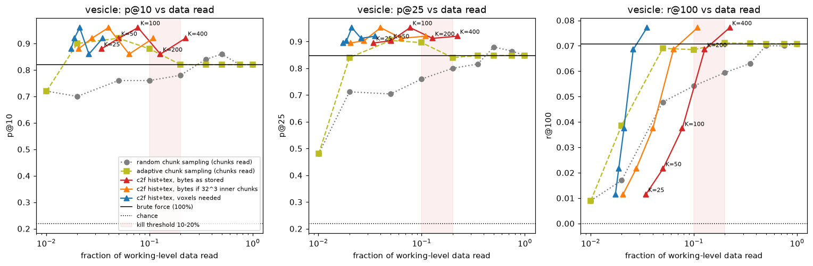
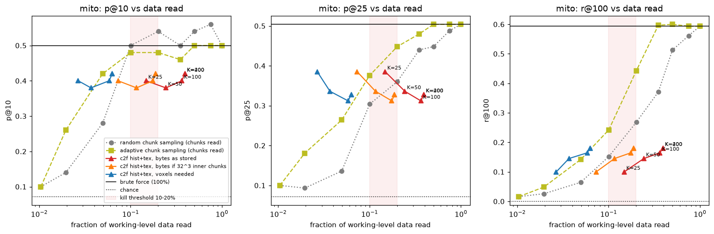
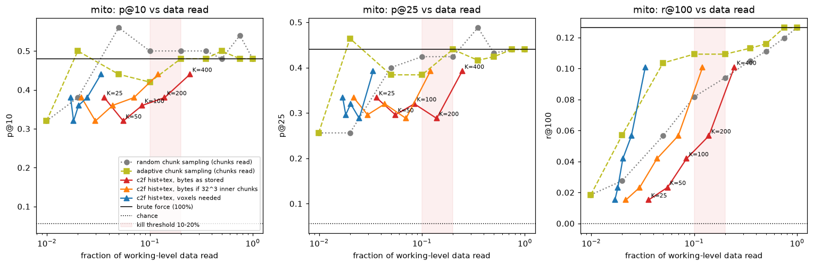
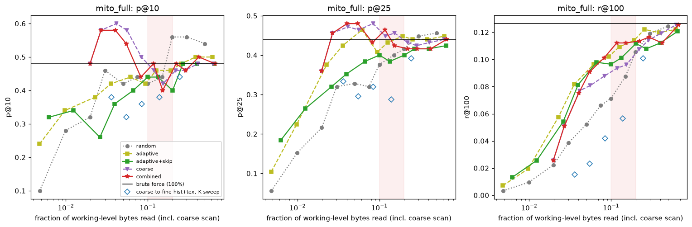
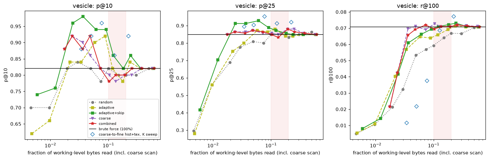
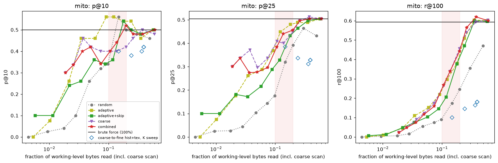

# coresample feasibility: results

1. **Test 1 passes as a where-is-the-content map, not as an organelle detector.** Free chunk sizes separate cell from resin (AUC 0.95; 0.98 for the free s0/s1 size ratio) and trace the nucleus and cell outline, but within the cell they predict mito or vesicles only weakly (AUC 0.57-0.71).
2. **Test 2, point-wise coarse-to-fine, passes for vesicles and fails for mito.** Vesicles match brute force on the top hits from s3, s4 or s5 while reading 3-8% of the working level's bytes as stored; mito need about 25% over the whole volume.
3. **Test 3: read the coarse scan's top chunks whole, embed everything in them.** That matches or beats brute force on the top hits at **2.4% of the bytes for vesicles and 2.7% for mito over the whole volume** (both including the coarse scan), well ahead of random or adaptive sampling at that budget. Mito in the 1/9 subvolume still miss on the top 25. The advantage is in the first hits only: past about 5% every strategy converges, and recall still needs most of the data.

Dataset: `jrc_hela-2` (OpenOrganelle), EM `recon-1/em/fibsem-uint8`, 6368 x 1600 x 12000
voxels at 5.24 x 4 x 4 nm, six 2x levels (s0 chunks 128^3, s1-s5 chunks 64^3, zstd 6),
read lazily from `s3://janelia-cosem-datasets`. Reference labels are the whole-volume COSEM
segmentations (`*_seg`, N5), used only to choose queries and grade; they are curated model
output, not manual ground truth, which exists only in 26 small crops. The search code
(`search.py`, `query.py`) never sees labels. Layout: [layout.md](layout.md).

## Test 1: compression heatmap

Map cell = one s0 chunk (128^3 voxels, 0.67 x 0.51 x 0.51 um); 54,684 full cells,
23,591 inside the cell (foreground mask > 50%). Sizes come from `chunkmap.py` (bucket
listing: 61,100 s0 sizes in 2 s, no pixels read). Label occupancy: mito and vesicle from
8 nm labels, the any-organelle union of 18 classes from 32 nm labels.

| signal | AUC cell vs resin | AUC mito, within cell | AUC vesicle, within cell | Spearman any-organelle, within cell |
|---|---|---|---|---|
| zarr uint8 zstd s0 size (free) | 0.95 | 0.67 | 0.57 | 0.79 |
| zarr uint8 zstd s1 size (free) | 0.89 | 0.69 | 0.66 | 0.62 |
| zarr uint8 zstd s2 size (free) | 0.92 | 0.66 | 0.55 | 0.62 |
| N5 uint16 gzip s0 size (free) | 0.94 | 0.69 | 0.57 | 0.81 |
| s0/s1 size ratio, same region (free) | **0.98** | 0.65 | 0.56 | 0.77 |
| s0 size minus local median (free) | 0.72 | 0.53 | 0.61 | 0.04 |
| residual from size-vs-coarse-intensity trend | 0.90 | 0.64 | 0.66 | 0.41 |
| abs(residual), outlier rank | 0.73 | 0.59 | 0.59 | 0.24 |
| EM s3 intensity std (reads 1/512 of s0) | 0.92 | 0.57 | 0.50 | 0.59 |

Across all cells, resin included, size predicts mito at AUC 0.87 and vesicles at 0.88, but
that is mostly "cell or resin". The maps ([test1_heatmaps.png](test1_heatmaps.png)) show
the nucleus with its chromatin texture, the cell outline and the mito-rich ring around the
nucleus.

- **Free beats a cheap read.** Within the cell, s0 chunk size (no pixels) predicts mito and
  vesicles better than the intensity std of EM s3: size carries fine-scale information that
  downsampling averages away.
- **Raw EM barely compresses.** s0 chunks are 1.0-1.6 MB of 2.1 MB raw (59.6 GB stored for
  122 GB); the median s1 chunk is 258 KB of 262 KB, close to stored raw. Size saturates where
  the texture is.
- **Compressor type barely matters.** N5 uint16 gzip gives the same picture as zarr uint8 zstd.
- **Acquisition state shows.** An anomalous z-plane, a z-band of larger background chunks, and
  a missing row in the foreground mask itself are all visible: the QA use (corruption,
  imaging changes, write progress).
- **The texture-vs-intensity residual** ([test1_residual.png](test1_residual.png)) helps
  vesicles a little (0.66 vs 0.57), not mito; its outlier rank is near chance for organelles
  and mostly finds nucleus texture and acquisition bands. Constant edge chunks must be left out
  of the trend fit or they dominate it.

`chunkmap.py` on real buckets (the handoff's open item; the parallel listing fix holds):

| dataset | levels | chunk sizes | time |
|---|---|---|---|
| jrc_hela-2 zarr, s0-s5 (`--max-chunks 5000000`) | 6 | 122,850 | 10.7 s |
| jrc_hela-2 N5 uint16, s0-s4 (new N5 support) | 5 | 540,741 grid positions | 17 s |
| hemibrain precomputed, sharded JPEG, 32-2048 nm | 7 | 3.47 M | 59 s (32 nm: 3.41 M in 44 s, 7,140 minishard index reads) |

The hemibrain map shows neuropil compartments and acquisition-slab seams from sizes alone
([chunkmap/hemibrain_32nm.png](chunkmap/hemibrain_32nm.png)). `chunkmap.py` now stretches
its colours over non-empty chunks; a few hundred constant edge chunks used to wash out the
cell.

## Test 2: coarse-to-fine recall

**Setup.** Subvolume s0 z 640-2688, all y, x 512-4608 (10.7 x 6.4 x 16.4 um, about 1/9 of the
volume: cytoplasm left of the nucleus, a nucleus edge, some resin;
[overview_s4.png](overview_s4.png)), plus the whole volume for mito. Five query instances per
class. A returned region is a patch^3 box at the working level; it is a hit if it contains an
instance centroid; results are non-overlapping (NMS) and exclude the query's own box.

| target | working level | patch | instances | chance precision | brute force |
|---|---|---|---|---|---|
| vesicle (hard) | s1, 8 nm | 64 px = 512 nm | 3,440 | 0.22 | 46,872 patches, 1.41 GB, 215 s to embed |
| mito (easy) | s2, 16 nm | 64 px = 1 um | 62 | 0.07 | 5,115 patches, 153 MB |
| mito, whole volume | s2 | 64 px | 421 | 0.06 | 48,576 patches, 1.28 GB, 204 s |

Coarse-to-fine: cheap scores over the whole coarsest level (FFT NCC with 8 in-plane
rotations, 16-bin histogram EMD, window texture stats: mean, std, gradient, DoG), keep K
peaks, rescore a small box around each at every finer level, then DINOv2-small (xy patch,
112 px input, CLS + mean token) ranks the survivors at the working level. Data read is
costed from the listing's real chunk sizes: as stored (whole 64^3 chunks), as if sharded
with 32^3 inner chunks, and as the voxels actually needed. Fractions are of the working
level over the searched region.

### Vesicles: pass

| method | p@10 | p@25 | r@100 | bytes as stored | 32^3 inner | voxels |
|---|---|---|---|---|---|---|
| brute force | 0.82 | 0.85 | 0.07 | 100% | 100% | 100% |
| c2f s3, K=25, hist+tex | 0.88 | 0.89 | 0.01 | **3.4%** | 2.1% | 1.7% |
| c2f s3, K=100, hist+tex | 0.96 | 0.95 | 0.04 | 7.7% | 4.0% | 2.1% |
| c2f s3, K=400, hist+tex | 0.92 | 0.92 | 0.08 | 22.3% | 10.9% | 3.5% |
| c2f s4, K=100, hist+tex | 0.98 | 0.91 | 0.03 | 6.8% | 3.1% | 0.8% |
| c2f s5, K=100, hist+tex | 0.92 | 0.86 | 0.03 | 6.7% | 2.9% | 0.6% |
| adaptive sampling, 2% of chunks | 0.90 | 0.84 | 0.04 | 2% | | |
| adaptive sampling, 5% of chunks | 0.92 | 0.90 | 0.07 | 5% | | |
| random sampling, 10% of chunks | 0.76 | 0.76 | 0.05 | 10% | | |

- **Coarsest usable level: s5** (128 nm), the coarsest the dataset has, although a single
  vesicle (40-100 nm) is sub-voxel there. The search finds vesicle-dense neighbourhoods by
  texture, which is what "a region containing a vesicle centroid" rewards. It is region-level
  search, not instance-level.
- **Rough results in seconds.** The cheap s4 scan alone (3.7 s, no embedding) gives p@10 0.84;
  the full s4 search (cheap 7 s, embed 0.6 s, about 96 MB) reaches p@10 0.98, against about 4
  minutes for brute force (215 s embedding, 1.41 GB).
- **Recall@100** is capped by K: 100 boxes cover few of 3,440 instances (brute force 0.07);
  K=400 reaches brute-force recall at 22% of bytes as stored, 11% with 32^3 inner chunks.

### Mito: fail

Subvolume:

| method | p@10 | p@25 | r@100 | bytes as stored | 32^3 inner | voxels |
|---|---|---|---|---|---|---|
| brute force | 0.50 | 0.50 | 0.59 | 100% | 100% | 100% |
| c2f s4, K=100, ncc+hist+tex | 0.46 | 0.41 | 0.21 | 29.7% | 16.4% | 4.7% |
| c2f s4, K=100, hist+tex | 0.40 | 0.31 | 0.16 | 36.4% | 17.5% | 5.8% |
| c2f s4, K=100, tex | 0.50 | 0.32 | 0.17 | 38.6% | 18.9% | 5.7% |
| c2f s4, K=25, hist+tex | 0.40 | 0.39 | 0.10 | 14.8% | 7.3% | 2.7% |
| c2f s3, K=100, hist+tex | 0.50 | 0.34 | 0.16 | 30.7% | 18.3% | 12.8% |
| random sampling, 10% of chunks | 0.50 | 0.30 | 0.15 | 10% | | |
| adaptive sampling, 20% of chunks | 0.48 | 0.45 | 0.44 | 20% | | |

Whole volume:

| method | p@10 | p@25 | r@100 | bytes as stored | 32^3 inner | voxels |
|---|---|---|---|---|---|---|
| brute force | 0.48 | 0.44 | 0.13 | 100% | 100% | 100% |
| c2f s4, K=25, hist+tex | 0.38 | 0.33 | 0.02 | 3.6% | 2.2% | 1.7% |
| c2f s4, K=100, hist+tex | 0.36 | 0.32 | 0.04 | 8.4% | 4.4% | 2.0% |
| c2f s4, K=400, hist+tex | 0.44 | 0.39 | 0.10 | 24.6% | 12.1% | 3.4% |
| random sampling, 5% of chunks | 0.56 | 0.40 | 0.06 | 5% | | |
| adaptive sampling, 2% of chunks | 0.50 | 0.46 | 0.06 | 2% | | |

- The cheap coarse ranking is the weak link: its p@10 is 0.28-0.44 at s4 (vesicles: 0.84 at s4, 0.90 at s3).
  Window statistics at 64 nm cannot tell mito from other membrane-rich cytoplasm; DINOv2
  re-ranking recovers the top 10 but the candidate set misses most instances.
- Searching more volume lowers the fraction as expected (K=100: 30-36% of the subvolume, 8% of
  the whole volume) but precision falls with it, and matching brute force then needs K=400.
- The "easy" target is the hard one for this method: mito are defined by shape, vesicle-rich
  regions by texture, and the cheap scores only see texture.

### Sensitivity

- **Cheap score.** Histogram and texture work; NCC alone does not (vesicle p@10 0.62, mito 0.24,
  mito coarse p@10 0.00): a rigid template does not follow shape and orientation even with 8
  rotations. A bug in the first run let NCC score flat windows (resin, padding) as huge matches;
  it is fixed (flat windows score 0) and every NCC row was rerun.
- **K.** Precision is roughly flat in K and noisy across queries, while recall and cost grow
  roughly linearly. At s4 over the subvolume there are
  only about 170 distinct peaks, so K=200 and K=400 coincide for mito there.
- **Coarsest level.** Vesicles: s5, s4 and s3 all match brute force. Mito: none does.
- **Chunk granularity dominates cost.** Bytes as stored are 4-9x the voxels needed, because one
  64-px slice reads a whole 64^3 chunk. Sharded zarr v3 with 32^3 inner chunks halves it.
- **Self-building index.** In the rerun, 68% (mito) and 44% (vesicle) of candidate embeddings
  came from the cache that earlier searches had filled (`cache/embeddings.sqlite`).

## Test 3: combining the cheap signals (follow-up)

Proposed at the end of Test 2 and run once, with parameters fixed in advance (seed 1% of
chunks, 0.5% random exploration, equal weight on prior and feedback; no tuning). Every
strategy reads whole working-level chunks and embeds every grid patch in each chunk it
reads, so they differ only in which chunks they read, in what order. Costs include the
whole coarsest level over the region (1.2% of working-level bytes) for coarse-using
strategies. Driver: `search.best_first_chunks`; harness: `test3_combined.py`.

| strategy | what it uses |
|---|---|
| random | nothing |
| adaptive | 1% random seeds, then expand around the best similarities |
| adaptive+skip | adaptive, never reading chunks the free size map calls empty |
| coarse | chunks in order of the cheap coarse scan (hist+tex at s4 for mito, s3 for vesicles) |
| combined | skip empty, seed with the coarse scan's top 1%, expand on coarse prior + neighbours' similarity |

The empty mask uses only s0 chunk sizes: near-constant chunks plus the lower Otsu class
when the split is clearly bimodal. Over the whole volume it marks 19% of chunks empty and
drops 60 of 23,591 cell chunks (0.25%), catching a third of the resin.

p@10 / p@25 at matched budgets (bytes read including the coarse scan in brackets):

| run | brute force | random, 1% | adaptive, 1% | coarse or combined, 1% | adaptive, 5% | coarse, 5% |
|---|---|---|---|---|---|---|
| vesicle | 0.82 / 0.85 | 0.70 / 0.56 | 0.66 / 0.56 | **0.92 / 0.86** (2.4%) | 0.90 / 0.87 (5.8%) | 0.82 / 0.86 (7.3%) |
| mito, whole volume | 0.48 / 0.44 | 0.28 / 0.15 | 0.34 / 0.22 | **0.58 / 0.46** (2.7%) | 0.44 / 0.46 (6.2%) | 0.50 / 0.48 (8.4%) |
| mito, subvolume | 0.50 / 0.50 | 0.03 / 0.03 | 0.07 / 0.07 | 0.34 / 0.34 (2.5%) | 0.46 / 0.29 (6.0%) | 0.40 / 0.34 (7.4%) |

- **The coarse scan is worth exactly its first few percent.** Reading its top-ranked chunks
  first gives brute-force-level top hits at about 2.5% of the bytes for vesicles and
  whole-volume mito; random and adaptive sampling need at least twice the bytes for the same
  precision, or never reach it below 20%.
- **Read chunks, not points.** At the same bytes, Test 2's descent to single candidates
  embedded one patch per candidate and lost the target when coarse localization was off; a
  chunk read whole costs the same bytes and embeds all of its 8 patches (whole-volume mito
  at about 3% of the bytes: p@10 0.38 point-wise, K=25, vs 0.58 chunk-wise).
- **Feedback and the size map add little.** `combined` tracks `coarse`; expansion around good
  hits does not beat the static coarse order, and skipping empty chunks helps vesicles a bit
  (p@25 0.91 at 2% of chunks) and nothing else consistently.
- **Recall is not instant.** r@100 grows with data read for every strategy; the gain is in the
  first good hits, which is what the browser shows first.
- The s4 whole-volume scan takes about 33 s in numpy (s3 over the subvolume, 36 s): fine for a
  test, the part to move to WebGPU.

## Kill rule

| target | top hits matched | data needed (as stored / 32^3 inner / voxels) | verdict |
|---|---|---|---|
| vesicle | yes (p@10, p@25 at or above brute force) | 3.4% / 2.1% / 1.7% | pass |
| mito, subvolume | p@10 only; p@25 at most 0.41 vs 0.50 | not reached | fail |
| mito, whole volume | at K=400 | 24.6% / 12.1% / 3.4% | fail (over 20% as stored) |
| vesicle, Test 3 chunk-wise | yes (p@10 0.92 vs 0.82, p@25 0.86 vs 0.85) | 2.4% as stored, incl. coarse scan | pass |
| mito, whole volume, Test 3 chunk-wise | yes (p@10 0.58 vs 0.48, p@25 0.46 vs 0.44) | 2.7% as stored, incl. coarse scan | pass |
| mito, subvolume, Test 3 chunk-wise | no (p@25 at most 0.37 below 10%) | not reached under 20% | fail |

The hard target was not lost at coarse levels. Point-wise descent fails the easy target
because the cheap scores do not localize it well enough; reading the coarse scan's top
chunks whole fixes that over the whole volume (the realistic search) but not in the
smaller subvolume, where 62 instances and 768 chunks leave little room. Test 3 is a
variant chosen after seeing Test 2, with parameters fixed in advance and no tuning; it
should be confirmed on another dataset before it is relied on.

## Caveats

- One dataset, one subvolume plus one whole-volume run (mito only), five queries per class.
- The hit rule is region-level and favours dense classes (vesicle chance precision 0.22).
- Labels are COSEM model segmentations, so grades inherit their errors.
- DINOv2-small on CPU, xy patches only (no orthogonal slices), 112 px input from 64 px.
- The coarse-scan time for s3 (about 45 s) includes NCC, which the sweeps computed for every
  query; histogram and texture alone take seconds at s4.
- Byte fractions depend on region size (per-candidate cost is absolute); the 32^3 inner-chunk
  figure assumes uniform byte density inside a stored chunk.

## What this means for the browser tool (untested)

- **Shape of the search:** click a region; scan the coarsest level with cheap scores (a few MB
  read); read the top-ranked working-level chunks whole and embed every patch in them;
  stream hits as they come; keep reading down the ranking for recall. That is what Test 3
  measured, and it gives the first good hits from about 2.5% of the data.
- **Smaller reads matter:** stored chunks cost 4-9x the voxels needed. Sharded datasets with
  small inner chunks (or reading thin slabs) would cut the bytes about in half again.
- **Shape-defined targets** remain the weak spot of the cheap scores; a shape-aware cheap score,
  or the embedding itself at a coarse level, is the next thing to test for them.
- **Move the scan to WebGPU:** box sums, FFTs and filters only; DINOv2-small through ONNX
  Runtime Web for about 500 patches per query.
- **Display and breadth:** a chunkmirage `chunksize://` source and a similarity layer
  (`Source.info` + `read(box)` under the `chunkmirage.sources` entry point); refkv
  (d-v-b/refkv) for chunk sizes and pyramids across ~25 formats, then a second domain
  (Sentinel-2 or a cloud-optimized GeoTIFF) and a second EM dataset to confirm Test 3.

## Reproduce

`uv run python test1_chunksize.py`, then `test2_coarse2fine.py` (first run), the rerun with
`--methods hist+tex --sweep k methods coarsest --method-sweep all ncc --suffix _fix`, the whole
volume with `--targets mito --region full --suffix _full --methods hist+tex --sweep k methods
--method-sweep all --coarsest 4`, then `test3_combined.py` and `test3_combined.py --targets
mito --region full --suffix _full`, and `report.py`. Raw numbers: `test1.json`,
`test2_*.json`, `test3_*.json`, `summary.json`.
